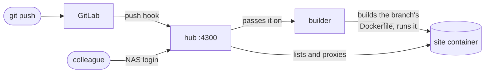

<div align="center">

# synology-site-hub

**Every git branch of your websites, live on your own Synology NAS, behind its login.**

**[Try the live demo](https://raulsimpetru.github.io/synology-site-hub/demo.html)** · [Project page](https://raulsimpetru.github.io/synology-site-hub/) · [MIT licence](LICENSE)


[How it works](#how-it-works) · [Install](#install-about-10-minutes) · [Add a website](#add-a-website) · [Limits](#limits)

</div>

---

Want to share a project wiki, a demo or a paper page with your colleagues, without putting it on the public internet? Push a branch that has a `Dockerfile`. About two minutes later it's live at `https://your-nas:4300/<uuid>/` for everyone in your group. Copy its link from the hub. Every push updates it, and deleting the branch takes it down.

- **Your NAS accounts.** People sign in through DSM's SSO Server, or with a shared password.
- **Fuzzy search.** Every running branch, grouped by project; type `rv2` to find `reviewer-2`.
- **A link for every page.** Each site lives at `/<uuid>/`, so any page can be shared, and several sites work side by side in tabs. A small "← All sites" badge leads back to the list. The hub still shows the project and branch names.
- **Nothing to set up per repo.** Anyone with a GitLab repo, even under their own name, pushes a `Dockerfile` and gets a site. No CI file, no runner, no settings.
- **Remove.** Only shown to people who can push to that branch; GitLab checks.
- **Build status.** A push shows up at once with a step track (Pushed, Queued, Build, Live); a live site stays open while its update builds, and a failed build shows its error line and build log.
- **Isolated sites.** No host mounts, no Linux capabilities, 1 GB of RAM each.
- **Small.** One TypeScript file on Bun, with tests.

## How it works



- **GitLab** sends every push to the hub (one system hook for the whole instance, or a webhook per group or project).
- **The builder** (`builder.ts`) downloads the pushed commit, and if it has a `Dockerfile` at the root, builds it and starts it as a locked-down container. It's the only part with the Docker socket, and no repo can change what it runs except its own Dockerfile.
- **The hub** (`router.ts`) lists the running containers through a read-only Docker API and serves each one under its own path, rewriting the site's root-relative links to match.

## What you need

- A Synology NAS with **DSM 7.2+** and **Container Manager**, which provides `docker` and `docker compose`.
- SSH access to the NAS with an account that can run `sudo`.
- **GitLab**: self-hosted, for example on the same NAS, or gitlab.com. GitLab must be able to reach the hub's port to deliver push hooks.
- Optional: DSM's **SSO Server** package, so people sign in with their NAS accounts.

## Install (about 10 minutes)

The hub is one Docker Compose project: the hub itself, a read-only window onto Docker, and the builder. Nothing to compile or copy by hand.

<details open>
<summary><b>1. Get the two files</b></summary>

<br>

Over SSH on the NAS:

```sh
mkdir -p /volume1/docker/site-hub && cd /volume1/docker/site-hub
curl -fsSLO https://raw.githubusercontent.com/RaulSimpetru/synology-site-hub/main/compose.yaml
curl -fsSL https://raw.githubusercontent.com/RaulSimpetru/synology-site-hub/main/.env.example -o .env && chmod 600 .env
```

No SSH? In DSM, put `compose.yaml` and `.env` in a folder with File Station, then go to **Container Manager → Project → Create** and pick that folder.

</details>

<details open>
<summary><b>2. Connect GitLab</b></summary>

<br>

1. **A token for the builder.** As a GitLab admin (on gitlab.com: an account that is a member of every site repo), go to Preferences → Access tokens and create a token with the scopes `read_api` and `read_repository`. That's `GITLAB_TOKEN`. Give it a long expiry: the builder stops building on the day it lapses.
2. **A secret for the hook:** `openssl rand -hex 32`. That's `HOOK_SECRET`.
3. **The push hook.** Self-hosted: Admin → System hooks → add `https://your-nas:4300/_hub/hook`, paste the secret as the Secret token, tick **Push events**. That covers every repo on the instance, including new ones. On gitlab.com: the same as a webhook on each group (or project) with your sites.

> **Self-hosted GitLab on the same network:** system hooks may call local addresses by default. Project and group webhooks may not: allow the hub's host and port only, under Admin → Settings → Network → Outbound requests → `your-nas.example.org:4300`.

</details>

<details open>
<summary><b>3. Fill in <code>.env</code> and start</b></summary>

<br>

Set at least these, then start it:

```sh
HUB_URL=https://your-nas.example.org:4300      # as people will type it
GITLAB_URL=https://your-gitlab.example.org     # or https://gitlab.com
GITLAB_TOKEN=glpat-…                           # from step 2
HOOK_SECRET=…                                  # from step 2
SESSION_SECRET=…                               # output of: openssl rand -hex 32
```

```sh
sudo docker compose up -d
```

- **Port:** the hub answers on port 4300; set `HUB_PORT` in `.env` to change it.
- **HTTPS:** the hub uses DSM's default certificate, so use the hostname it's issued for.
- **Firewall:** if DSM's firewall is on, allow the port.

</details>

<details>
<summary><b>4. Sign-in with NAS accounts</b> (recommended)</summary>

<br>

1. Install **SSO Server** in DSM.
2. SSO Server → Application → Add → OIDC, with the redirect URI `https://your-nas:4300/_hub/callback`.
3. In `.env`, set `OIDC_ISSUER` (shown by SSO Server, usually `https://your-nas:8843/webman/sso`), `OIDC_CLIENT_ID` and `OIDC_CLIENT_SECRET`.
4. Run `sudo docker compose up -d`.

Without SSO, set `HUB_PASSWORD` instead and everyone shares that password. With neither, the hub is open to anyone who can reach the port.

</details>

<details>
<summary><b>5. Remove button</b> (optional)</summary>

<br>

1. In GitLab: Admin → Applications → New application (on gitlab.com: your group's Settings → Applications).
2. Redirect URI `https://your-nas:4300/_hub/gitlab`, scope `api`, and tick "Trusted" if you can, so nobody sees a consent screen.
3. In `.env`, set `GITLAB_CLIENT_ID` and `GITLAB_CLIENT_SECRET`.
4. Run `sudo docker compose up -d`.

Each person is signed into GitLab once, which is usually invisible behind SSO. The hub then shows Remove on branches they can push to. Removing takes the site down; the branch itself is never touched.

</details>

### Settings

All settings live in `.env` on the NAS; [`.env.example`](.env.example) lists them.

| Variable | Needed for | Example |
|---|---|---|
| `HUB_URL` | always | `https://your-nas.example.org:4300` |
| `GITLAB_URL`, `GITLAB_TOKEN`, `HOOK_SECRET` | building sites | `https://gitlab.com`, `glpat-…`, `openssl rand -hex 32` |
| `HUB_ORG` | label at the top right | `Example Lab` |
| `SESSION_SECRET` | staying signed in across restarts | output of `openssl rand -hex 32` |
| `OIDC_ISSUER`, `OIDC_CLIENT_ID`, `OIDC_CLIENT_SECRET` | NAS sign-in | from DSM's SSO Server |
| `HUB_PASSWORD` | shared password instead of SSO | |
| `GITLAB_CLIENT_ID`, `GITLAB_CLIENT_SECRET` | the Remove button | from a GitLab OAuth app |
| `HUB_PORT`, `HUB_VERSION`, `CERT_DIR` | port, image tag, certificate folder | `4300`, `latest`, DSM's default |

## Add a website

Add a **`Dockerfile`** at the repo root whose server listens on `$PORT` (3000), and push. [`examples/Dockerfile.bun`](examples/Dockerfile.bun) is a starting point. That's all: no CI file, no runner, no settings.

The site appears at `https://your-nas:4300/<uuid>/`; copy its link from the hub. The UUID is derived from the full project path and branch and stays the same across rebuilds. Previous repository/branch URLs redirect to the UUID path when unambiguous. Every push updates the preview, and deleting the branch or repo takes it down. Repos without a root `Dockerfile` are ignored.

> **Secrets:** add a CI/CD variable `SITE_ENV_<NAME>` (Settings → CI/CD → Variables, masked). The site receives it as `<NAME>`, so `SITE_ENV_SMTP_PASS` becomes `SMTP_PASS`. It's passed when the container starts, so it never ends up in the image. A new variable takes effect on the next push.

## Limits

- **Sites are served under a path.** Plain links, images, forms and redirects are rewritten automatically, and URLs that a site's JavaScript builds are routed by the page that asked for them. A single-page app with its own router may need its base path set; the hub sends it as the `X-Forwarded-Prefix` header.
- **No WebSockets** through the hub.
- **No persistent storage.** Whatever a site writes to disk is gone on its next deploy, so send data elsewhere, for example by email.
- **CPU priority, not a cap.** The Synology kernel can't hard-limit CPU, so sites get a lower priority instead.

- **One build at a time,** 20 minutes at most each, so a burst of pushes can't swamp the NAS.
- **Every repo with a root Dockerfile becomes a site,** on every branch. A repo that has one for another purpose shows up too, until its Dockerfile moves out of the root.

> [!IMPORTANT]
> Only the builder holds the Docker socket, which is root on the NAS, and it only ever runs `docker build` and a fixed `docker run` with no host mounts and no capabilities. Anyone who can push a repo can still run code on the NAS *inside* a build or a site container, so only connect a GitLab whose users you trust that far. `GITLAB_TOKEN` can read every repo: keep `.env` at `chmod 600`.

## Updating

```sh
sudo docker compose pull && sudo docker compose up -d --remove-orphans
```

`--remove-orphans` clears out the GitLab runner that versions before the builder used; then delete that runner in GitLab and clear the projects' CI/CD configuration file setting.

Every push to `main` here publishes a new image to `ghcr.io/raulsimpetru/synology-site-hub`. To stay on one version, set `HUB_VERSION` to a commit hash.

## Development

- **Tests:** `bun test`. They also run on every push and pull request, before an image is published.
- **Try local changes:** `docker build -t ghcr.io/raulsimpetru/synology-site-hub:dev .`, then set `HUB_VERSION=dev`.
- **Project page:** `docs/` is the GitHub Pages site, served from `main` / `docs`. `docs/demo.html` is the real hub page with made-up sites; rebuild it after changing `router.ts` with `bun scripts/demo.ts`.

## Licence

[MIT](LICENSE), made by Raul C. Sîmpetru.
