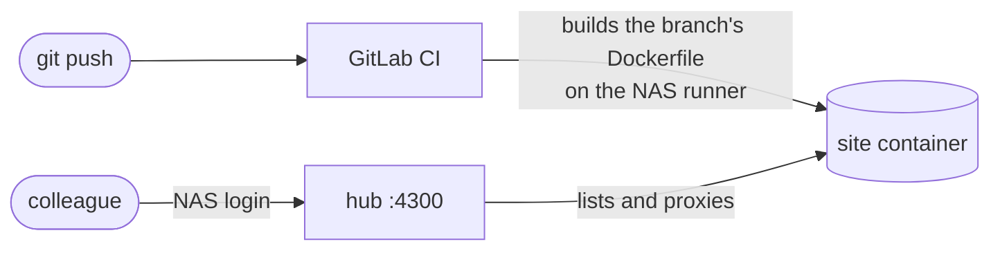

<div align="center">

# synology-site-hub

**Every git branch of your websites, live on your own Synology NAS, behind its login.**

**[Try the live demo](https://raulsimpetru.github.io/synology-site-hub/demo.html)** · [Project page](https://raulsimpetru.github.io/synology-site-hub/) · [MIT licence](LICENSE)


[How it works](#how-it-works) · [Install](#install-about-10-minutes) · [Add a website](#add-a-website) · [Limits](#limits)

</div>

---

Want to share a project wiki, a demo or a paper page with your colleagues, without putting it on the public internet? Push a branch that has a `Dockerfile`. About two minutes later it's live at `https://your-nas:4300/<repo>/<branch>/` for everyone in your group. Every push updates it, and deleting the branch takes it down.

- **Your NAS accounts.** People sign in through DSM's SSO Server, or with a shared password.
- **Fuzzy search.** Every running branch, grouped by project; type `rv2` to find `reviewer-2`.
- **A link for every page.** Each site lives at `/<repo>/<branch>/`, so any page can be shared, and several sites work side by side in tabs. A small "← All sites" badge leads back to the list.
- **Remove.** Only shown to people who can push to that branch; GitLab checks and records it.
- **Build status.** A push shows up at once with a step track (Pushed, Queued, Build, Live); a live site stays open while its update builds, and a failed build shows its error line and job log.
- **Isolated sites.** No host mounts, no Linux capabilities, 1 GB of RAM each.
- **Small.** One TypeScript file on Bun, with tests.

## How it works



- **GitLab CI** builds each branch on a runner on the NAS and starts it as a container. Projects point their CI setting at the template the hub serves.
- **The hub** (`router.ts`) lists the running containers through a read-only Docker API and serves each one under its own path, rewriting the site's root-relative links to match.
- **Removing** a preview stops its GitLab environment, which runs the template's stop job.

## What you need

- A Synology NAS with **DSM 7.2+** and **Container Manager**, which provides `docker` and `docker compose`.
- SSH access to the NAS with an account that can run `sudo`.
- **GitLab**: self-hosted, for example on the same NAS, or gitlab.com. The runner only connects out to GitLab.
- Optional: DSM's **SSO Server** package, so people sign in with their NAS accounts.

## Install (about 10 minutes)

The hub is one Docker Compose project: the hub itself, a read-only window onto Docker, and a GitLab runner that builds the sites. Nothing to compile or copy by hand.

<details open>
<summary><b>1. Get the two files</b></summary>

<br>

Over SSH on the NAS:

```sh
mkdir -p /volume1/docker/site-hub && cd /volume1/docker/site-hub
curl -fsSLO https://raw.githubusercontent.com/RaulSimpetru/synology-site-hub/main/compose.yaml
curl -fsSL https://raw.githubusercontent.com/RaulSimpetru/synology-site-hub/main/.env.example -o .env && chmod 600 .env
```

No SSH? In DSM, put `compose.yaml` and `.env` in a folder with File Station, then go to **Container Manager → Project → Create** and pick that folder.

</details>

<details open>
<summary><b>2. Make a runner in GitLab</b></summary>

<br>

In GitLab, open the group that holds your websites (or a single project) → Settings → CI/CD → Runners → **New group runner**.

- Set the tag `site-hub`.
- Untick "Run untagged jobs".
- Copy the `glrt-…` token.

A group runner serves every project in the group. A project runner works too, but then you enable it on each project.

</details>

<details open>
<summary><b>3. Fill in <code>.env</code> and start</b></summary>

<br>

Set at least these, then start it:

```sh
HUB_URL=https://your-nas.example.org:4300      # as people will type it
GITLAB_URL=https://your-gitlab.example.org     # or https://gitlab.com
RUNNER_TOKEN=glrt-…                            # from step 2
SESSION_SECRET=…                               # output of: openssl rand -hex 32
```

```sh
sudo docker compose up -d
```

- **Port:** the hub answers on port 4300; set `HUB_PORT` in `.env` to change it.
- **HTTPS:** the hub uses DSM's default certificate, so use the hostname it's issued for.
- **Firewall:** if DSM's firewall is on, allow the port.
- **Runner:** it registers itself on the first start.

</details>

<details>
<summary><b>4. Sign-in with NAS accounts</b> (recommended)</summary>

<br>

1. Install **SSO Server** in DSM.
2. SSO Server → Application → Add → OIDC, with the redirect URI `https://your-nas:4300/_hub/callback`.
3. In `.env`, set `OIDC_ISSUER` (shown by SSO Server, usually `https://your-nas:8843/webman/sso`), `OIDC_CLIENT_ID` and `OIDC_CLIENT_SECRET`.
4. Run `sudo docker compose up -d`.

Without SSO, set `HUB_PASSWORD` instead and everyone shares that password. With neither, the hub is open to anyone who can reach the port.

</details>

<details>
<summary><b>5. Remove button and build status</b> (optional)</summary>

<br>

1. In GitLab: Admin → Applications → New application (on gitlab.com: your group's Settings → Applications).
2. Redirect URI `https://your-nas:4300/_hub/gitlab`, scope `api`, and tick "Trusted" if you can, so nobody sees a consent screen.
3. In `.env`, set `GITLAB_CLIENT_ID` and `GITLAB_CLIENT_SECRET`.
4. Run `sudo docker compose up -d`.

Each person is signed into GitLab once, which is usually invisible behind SSO. The hub then shows each branch's build progress, and Remove on branches they can push to. Remove stops the branch's GitLab environment *as that person*; the branch itself is never touched.

</details>

### Settings

All settings live in `.env` on the NAS; [`.env.example`](.env.example) lists them.

| Variable | Needed for | Example |
|---|---|---|
| `HUB_URL` | always | `https://your-nas.example.org:4300` |
| `GITLAB_URL`, `RUNNER_TOKEN` | building sites | `https://gitlab.com`, `glrt-…` |
| `HUB_ORG` | label at the top right | `Example Lab` |
| `SESSION_SECRET` | staying signed in across restarts | output of `openssl rand -hex 32` |
| `OIDC_ISSUER`, `OIDC_CLIENT_ID`, `OIDC_CLIENT_SECRET` | NAS sign-in | from DSM's SSO Server |
| `HUB_PASSWORD` | shared password instead of SSO | |
| `GITLAB_CLIENT_ID`, `GITLAB_CLIENT_SECRET` | Remove and build status | from a GitLab OAuth app |
| `HUB_PORT`, `HUB_VERSION`, `CERT_DIR` | port, image tag, certificate folder | `4300`, `latest`, DSM's default |

## Add a website

1. Add a **`Dockerfile`** at the repo root whose server listens on `$PORT` (3000). [`examples/Dockerfile.bun`](examples/Dockerfile.bun) is a starting point.
2. In the project, go to Settings → CI/CD → General pipelines, and set the **CI/CD configuration file** to `https://your-nas:4300/_hub/ci.yml`. The hub serves the build template there with its own address filled in. Don't add a `.gitlab-ci.yml` of your own.
3. With a project runner (not a group runner): Settings → CI/CD → Runners → **enable the `site-hub` runner**.

> If GitLab can't fetch the template from the hub (no network path, or a self-signed certificate), put [`review.gitlab-ci.yml`](review.gitlab-ci.yml) in a GitLab project of its own, set its `HUB_URL`, and use `review.gitlab-ci.yml@<group>/<project>` instead.

Then push a branch. It appears at `https://your-nas:4300/<repo>/<branch>/` (the branch name as GitLab slugs it, e.g. `feature/x` → `feature-x`). The pipeline's environment URL leads there too.

> **Secrets:** add a CI/CD variable `SITE_ENV_<NAME>` (masked, not protected). The site receives it as `<NAME>`, so `SITE_ENV_SMTP_PASS` becomes `SMTP_PASS`. It's written after `docker build`, so it never ends up in the image.

## Limits

- **Sites are served under a path.** Plain links, images, forms and redirects are rewritten automatically, and URLs that a site's JavaScript builds are routed by the page that asked for them. A single-page app with its own router may need its base path set; the hub sends it as the `X-Forwarded-Prefix` header.
- **No WebSockets** through the hub.
- **No persistent storage.** Whatever a site writes to disk is gone on its next deploy, so send data elsewhere, for example by email.
- **CPU priority, not a cap.** The Synology kernel can't hard-limit CPU, so sites get a lower priority instead.

> [!IMPORTANT]
> The CI jobs hold the Docker socket, which is root on the NAS. That's why projects use the hub's CI template instead of their own, and branches can only supply a Dockerfile.
> - Enable the runner only for projects set up as in [Add a website](#add-a-website).
> - Give people the **Developer** role on site projects. A Maintainer could point the project back at its own CI file.

## Updating

```sh
sudo docker compose pull && sudo docker compose up -d
```

Every push to `main` here publishes a new image to `ghcr.io/raulsimpetru/synology-site-hub`. To stay on one version, set `HUB_VERSION` to a commit hash.

## Development

- **Tests:** `bun test`. They also run on every push and pull request, before an image is published.
- **Try local changes:** `docker build -t ghcr.io/raulsimpetru/synology-site-hub:dev .`, then set `HUB_VERSION=dev`.
- **Project page:** `docs/` is the GitHub Pages site, served from `main` / `docs`. `docs/demo.html` is the real hub page with made-up sites; rebuild it after changing `router.ts` with `bun scripts/demo.ts`.

## Licence

[MIT](LICENSE), made by Raul C. Sîmpetru.
